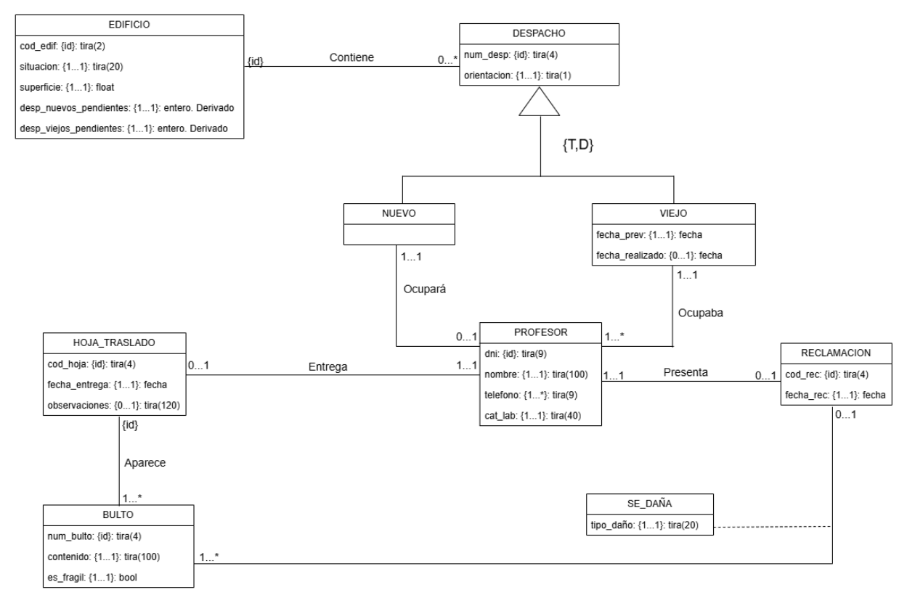
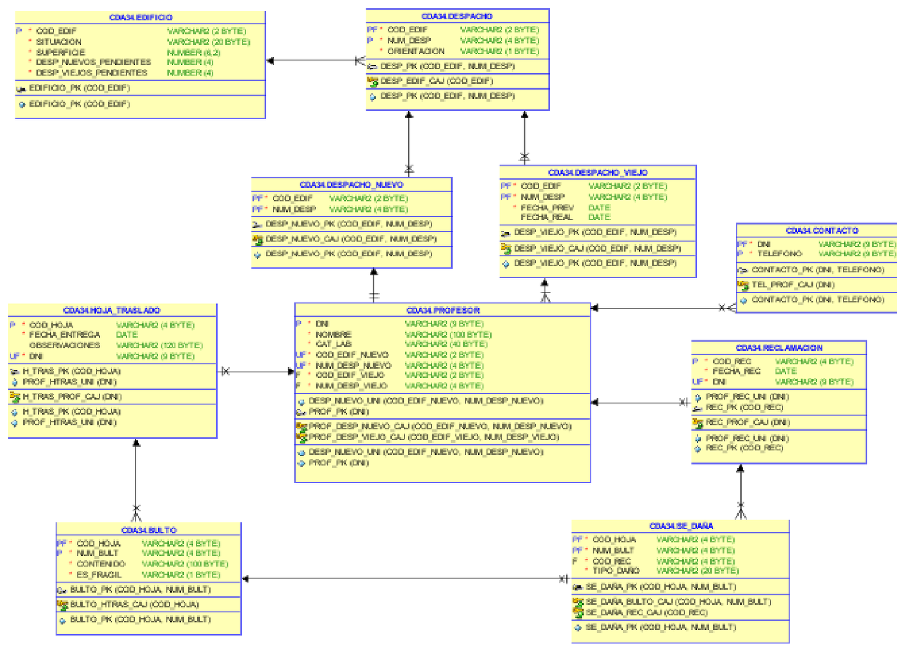
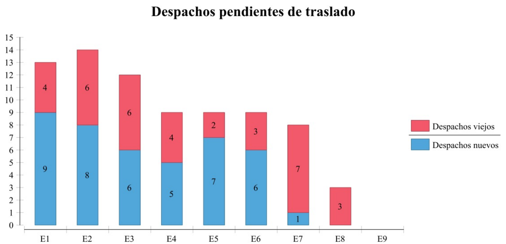

# Multi-Paradigm Database Modelling: DSIC Office Relocation

One business problem, modelled and implemented three times: **relational (Oracle)**, **wide-column (Cassandra)** and **graph (Neo4j)**.

## About the project

University team project (4 students) for the *Databases* and *Data Management* courses of the Data Science degree at the Universitat Politècnica de València (UPV).

A university department is moving from its old offices to new ones. The system tracks buildings, offices, professors, moving forms, packages and damage claims. Designing the same domain for three different database paradigms shows how the right model depends on the access patterns, not only on the data.

## Reports

The full write-ups are in [`docs/`](docs/). They are written in Spanish.

| Report | Content |
|---|---|
| [Databases: Oracle](docs/databases-report-oracle.pdf) | Conceptual design, logical design and normalisation, table creation, data load, PL/SQL programming and BIRT reports |
| [Data Management: Cassandra and Neo4j](docs/data-management-cassandra-neo4j-report.pdf) | Query-first design for Cassandra, graph design for Neo4j, data migration from Oracle and queries |

## At a glance

| | Oracle | Cassandra | Neo4j |
|---|---|---|---|
| **Model** | 10 tables in 3NF | 12 tables and 2 user-defined types | Property graph |
| **Design driver** | Normalisation and integrity | 8 queries from the access-pattern workflow | Relationships between entities |
| **Programming** | PL/SQL functions, procedures and triggers | CQL queries | 7 uniqueness constraints and 8 Cypher queries |
| **Extras** | 6 BIRT reports | Chebotko diagram | About 2,380 nodes and 2,638 relationships |

## Same problem, three designs

| Concept | Oracle | Cassandra | Neo4j |
|---|---|---|---|
| Old / new offices (specialisation) | Two tables referencing `DESPACHO` | One table with a `tipo` column | Multi-label nodes `:Despacho:Nuevo` and `:Despacho:Viejo` |
| Professor's phone numbers | Separate `CONTACTO` table | `set<text>` column | List property on the node |
| Packages of a moving form | `BULTO` table | Collection of a user-defined type inside the form | `Bulto` nodes linked to the form |
| Damaged packages in a claim | `SE_DAÑA` association table | Collection of a user-defined type inside the claim | `Asociada` relationship with a `motivo` property |

## Figures

**Conceptual design (UML class diagram)**

**Relational model generated with Oracle SQL Developer Data Modeler**

**BIRT report: offices pending relocation per building**

## What this project shows

- Conceptual modelling with UML: specialisation, weak classes, association classes, multivalued and derived attributes.
- Logical design and normalisation up to 3NF, with referential integrity rules.
- Query-first design in Cassandra and graph modelling in Neo4j.
- Migrating data between paradigms through CSV exports.
- Business reporting with BIRT.

## My contribution

<!-- TODO: write here, in the first person, what you did in the project. -->

## Tech

Oracle SQL/PL-SQL · Cassandra (CQL) · Neo4j (Cypher) · BIRT · Oracle SQL Developer Data Modeler
